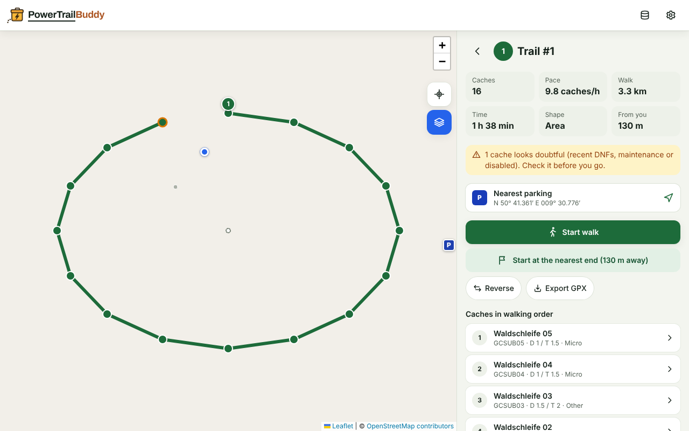

# PowerTrailBuddy

Find the power trails hiding in your own Pocket Queries, and walk them. 🥾

## Motivation

A **power trail** is a chain of quick geocaches laid out along a path, a
few hundred metres apart. They are great for a walk with a high find rate,
but you only notice one when you already happen to be standing on it.

PowerTrailBuddy looks at the caches in your own Geocaching.com **Pocket
Query** and finds the clusters and chains worth walking: it links caches
that are close to each other, puts them in a sensible walking order, splits
long chains into walks of a length you choose, and ranks them by caches per
hour. Then it guides you through one, cache by cache, on a map.

  
  
  

The screenshots use the bundled sample data; the map background is left
plain, as they are taken without the tile server.

## Features

- **Import only, nothing leaves your device unasked**: open a Pocket Query
  `.zip` or `.gpx` file, or share it to the app from your phone's e-mail or
  files app. No login, no server, no tracking; the map is fetched from the
  internet, and trail caches' coordinates go to a routing server only if you
  turn on walking routes. **Try with sample data** shows the app before you
  have a Pocket Query. A newer run of the same query replaces its caches, so
  what was archived or found since leaves your trails.
- **Walking routes** (opt-in): distances on real footpaths from
  OpenStreetMap's routing server, and trails split where a motorway or river
  lies between two caches.
- **Trail finder** with your own limits, or a preset: cache types,
  difficulty and terrain, the largest gap between caches, the smallest trail
  worth walking, the longest walk, and round trips only, ending back near the
  start.
- **Ranked trails** with distance, time, caches per hour, line or area, how
  far away they are, and warnings for caches with recent DNFs, maintenance
  requests or a disabled listing; sort, filter and search.
- **Trail and cache details**: the nearest parking, the caches in walking
  order either way round, the latest logs and the hint, and links to the cache
  page, your navigation app and Google Maps walking directions; a cache on no
  trail says why.
- **Guided walk**, from either end or any cache you pick: the next cache
  with distance, a compass arrow and a "you're close" alert; found, not
  found, skip and undo; reverse or finish early; progress kept if you close
  the app.
- **Exports**: field notes to log a whole walk at once through
  geocaching.com's Drafts upload, and a trail as GPX for another navigation
  app.
- **Mark found or ignore** caches in the app, so they leave every trail.
- **Installable** on Android and iOS as an app that works offline once
  loaded, with the map tiles you viewed online, and opens without waiting on
  a weak signal.
- **Bilingual**: German and English.

## Using PowerTrailBuddy

1. On geocaching.com, create a **Pocket Query** for the area you want to
   walk (up to 1,000 caches; Traditional caches only works best).
2. Download its `.zip`, or open the e-mail it sends you.
3. Open PowerTrailBuddy and import the file — or, on Android, **share** the
   file to PowerTrailBuddy.

Step by step: [Getting started](docs/tutorials/getting-started.md). Every
task: [User guide](docs/how-to/user-guide.md).

PowerTrailBuddy is not affiliated with Groundspeak / Geocaching HQ. It only
reads files you downloaded yourself.

## Documentation

Full docs live in [`docs/`](docs/README.md), organised by
[Diátaxis](https://diataxis.fr):

- **Tutorial**: [Getting started](docs/tutorials/getting-started.md)
- **How-to**: [User guide](docs/how-to/user-guide.md) · [Developer guide](docs/how-to/developer-guide.md)
- **Reference**: [Architecture](docs/reference/architecture.md) · [Configuration](docs/reference/configuration.md) · [Risk model](docs/reference/risk-model.md)
- **Explanation**: [Design decisions](docs/explanation/design-decisions.md)

Testing methodology: [TEST_STRATEGY.md](TEST_STRATEGY.md).

## Contributing

PowerTrailBuddy is a personal hobby project and doesn't accept outside pull
requests, issues or feature requests. Want to change something? Fork it:
[CONTRIBUTING.md](CONTRIBUTING.md) has local setup and the checks CI runs.
