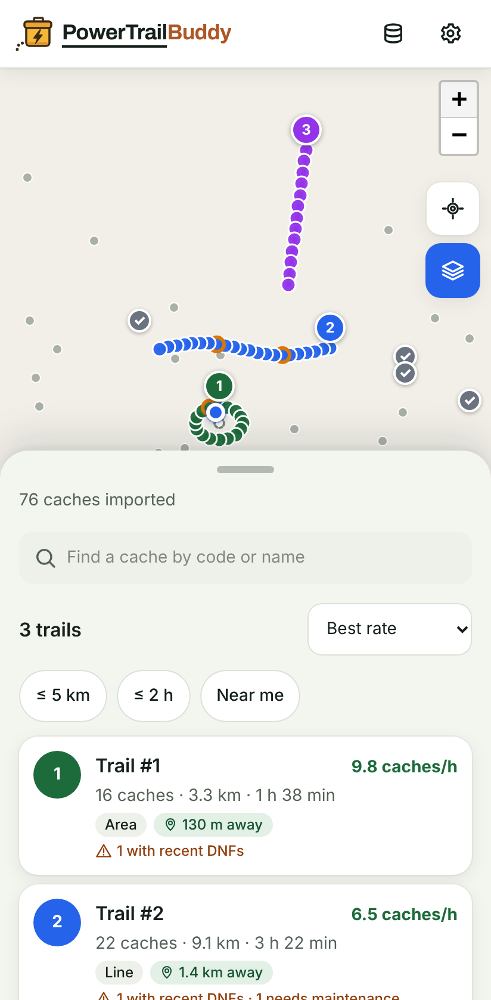
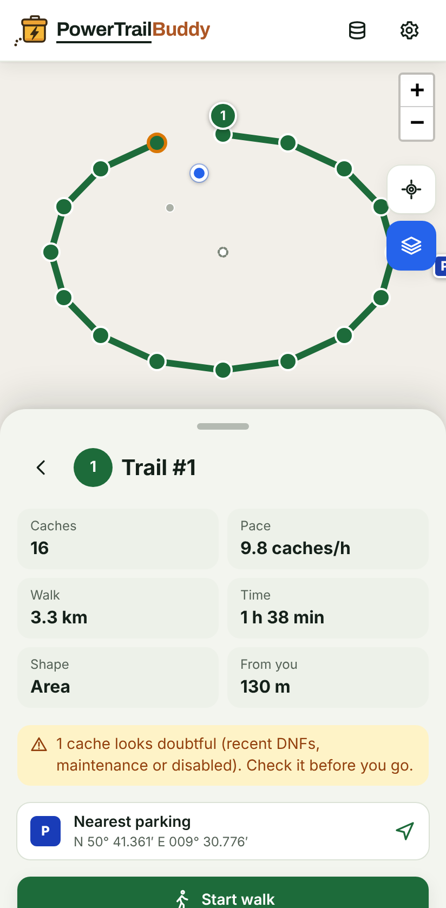
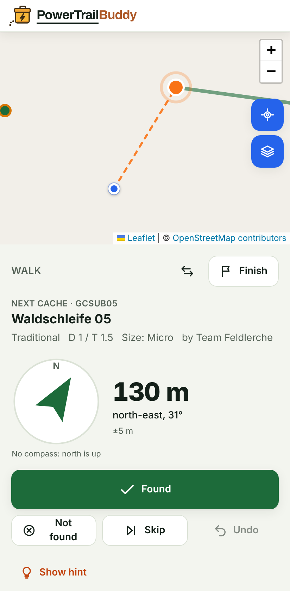
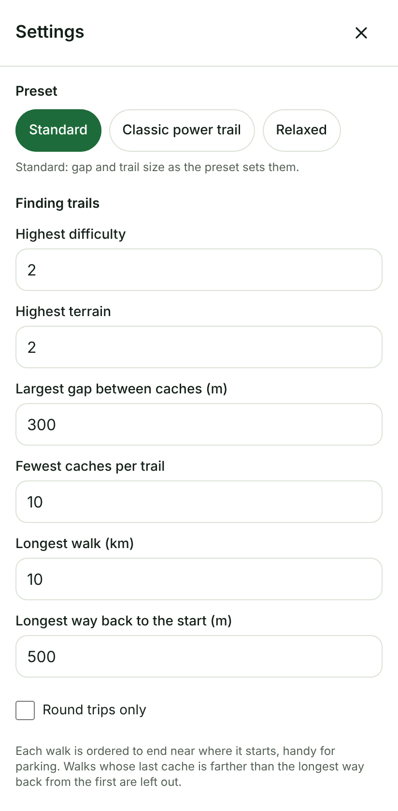

# User guide

Every task in PowerTrailBuddy. First time? Start with
[Getting started](../tutorials/getting-started.md).

PowerTrailBuddy only reads files you downloaded yourself; it never signs in
to geocaching.com and never sends your data anywhere. The only thing it
loads from the internet is the OpenStreetMap map.

## Create a Pocket Query for power trails

Pocket Queries are a Geocaching.com Premium feature, under **Play → Pocket
Queries**.

- **At most 1,000 caches** per query, the site's limit. For a larger area,
  create several queries with neighbouring centres and import them all; the
  app merges them.
- **Traditional only** is recommended. Other types can be included in
  [Settings](#change-the-trail-settings), but power trails are made of
  Traditionals and every extra cache makes the import slower.
- **That I haven't found** and **Is enabled**: found caches and disabled ones
  are left out of trails anyway, so including them only costs space.
- **Difficulty and terrain up to 2** matches the default settings.
- **Compress files into a .zip**: the app reads the zip directly.

## Get the Pocket Query file

- **Download**: once the query has run, its `.zip` is under **Ready for
  download** on the Pocket Queries page for a few days. This works for any
  size up to 1,000 caches.
- **E-mail**: queries with up to 500 caches are also e-mailed as an
  attachment. Save the attachment, or share it straight to the app (below).

The zip holds one `.gpx` file with the caches and usually a second
`*-wpts.gpx` with additional waypoints (parking, stages). Import the zip, or
both files together: the parking areas are attached to their caches, the
other additional waypoints are skipped.

GPX files exported from GSAK, Locus Map, c:geo or Cachly use the same format
and import too.

## Try it without a Pocket Query

On the first screen, **Try with sample data** loads an invented Pocket Query
(three trails somewhere that does not exist) so you can look around. Clear it
from **Your data** when you are done.

## Import files

Choose **Import Pocket Query** and pick one or more `.zip` or `.gpx` files;
later, **Your data → Import more** does the same. The app says how many caches
it read from how many files, and why it refused a file:

- **not a geocache .zip or .gpx file**: another kind of file, or XML that is
  not GPX;
- **damaged**: the file could not be read, or a zip is broken;
- **too large**: a zip of more than 50 files or more than 100 MB unpacked, or
  any file over 100 MB.

Importing again adds to what is already there: a cache imported twice is
kept once, the newer file's details winning. A newer run of the same Pocket
Query replaces that query's caches: one it no longer lists, because it was
archived, disabled or found online since, is removed, and the summary says
how many went. The app knows a query by the name of its `.gpx` file (a
Pocket Query's is its number, as in `26071826.gpx`, inside the zip too), so
renaming the zip or downloading it twice changes nothing. Caches of other
queries stay, so several queries for a bigger area work side by side; a cache
two queries list stays while either still does. Caches imported before this
version know no query and stay until you delete your data or ignore them.
Parking areas in the `*-wpts.gpx` of a Pocket Query are attached to their
caches.

Name other GPX files you import (from GSAK, c:geo, …) after what they hold:
importing a different area under the same file name replaces the first
area's caches.

## Share a file to the app (Android)

Install the app first ([below](#install-the-app)); Android only offers
installed web apps in the share sheet. Then, in your e-mail or files app,
share the `.zip` or `.gpx` and pick **PowerTrailBuddy**. The app opens,
names the shared files and imports them when you tap **Import**; **Cancel**
drops them. It asks because any website could send a file there. Sharing
works offline too. A share of more than 20 files or 100 MB is refused; the
app then says that no file arrived.

iOS does not let web apps receive shared files; use **Import** there.

## Pick a trail

Trails are numbered best first: most caches per hour, then most caches. Each
card shows its number of caches, walking distance and time, caches per hour,
whether it is a **line** (a chain along a path) or an **area** (a cluster to
criss-cross), how far away it is once the app knows your position, and a
warning when some of its caches look doubtful (recent DNFs, needing
maintenance, disabled).

- **Sort** by best rate, most caches, nearest to you or shortest.
- **Filter** to walks of at most 5 km, at most 2 hours, or within 10 km of
  you.
- **Find a cache** by code or name with the search box.
- On the map, tap a trail's numbered badge or line to open it; the layers
  button shows or hides the caches that are on no trail, the target button
  shows and follows your position until you drag or zoom the map yourself.

On a phone the list sits in a panel over the map: drag or tap its handle to
make it small, half or full height.

Long chains are split into several walks no longer than the
[maximum walk length](#change-the-trail-settings).

## Look at a trail

A trail shows its numbers, the nearest parking with a link that opens your
navigation app (Apple Maps on an iPhone, iPad or Mac), and its caches in
walking order. **Reverse** walks it the
other way round. **Export GPX** saves `powertrail-<number>.gpx` with the caches
in order, the parking and a route, for a navigation app such as OsmAnd or
Locus. Open a cache in the list for its links and marks.

## Look at a cache

A cache shows its code, name, type, ratings, size and owner, how far away and
in which direction it is, its latest logs and its hint (hidden until you ask).
Its links open the cache page (`coord.info`, or the Geocaching app when
installed), your navigation app (Apple Maps on an iPhone, iPad or Mac), or
Google Maps walking directions; **Copy**
puts its coordinates on the clipboard as geocachers write them
(`N 50° 18.000′ E 008° 54.000′`).

- **Mark as found** takes a cache you found without the app's walk out of
  every trail, until the next Pocket Query no longer lists it.
- **Ignore** takes out a cache you do not want to walk to, for good.

Both show a message with **Undo**. **Settings** lists the ignored caches, to
bring one back, and forgets every cache marked found at once.

A cache on a trail links to it and offers **Start the walk here**, to begin
the walk at that cache: on a round trip, the one next to your parking or
stop. A cache on no trail says why: a type, difficulty or terrain outside your
[trail settings](#change-the-trail-settings) (with a link to them), disabled,
archived, found, or marked in the app. One that passes them all has too few
caches close by for a trail.

## Walk a trail

**Start walk** begins at the first cache of the order shown; once the app
knows where you are, **Start at the nearest end** begins at whichever end is
closer; **Start the walk here** on a cache begins at that cache, going on in
the trail's order (on a trail that is not a round trip, the walk then crosses
from its last cache back to its first). The walk shows the next cache, its distance and direction with a
compass arrow (allow location access, and on iPhone tap **Use the compass**),
and how accurate your position is. Within 30 m it says you are close and the
phone vibrates once.

- **Found**, **Not found** (a DNF) or **Skip** moves on to the next cache;
  **Undo** takes the last one back.
- The reverse button turns the rest of the walk around.
- **Finish** ends early; **Resume walk** goes on.
- The map keeps you and the next cache in view. Drag or zoom it and it stays
  where you put it; the target button follows you again.

The screen stays on while you walk, and the walk is saved as you go: reopen
the app to continue. Caches you mark found are left out of every trail, even
before your next Pocket Query.

At the end, the summary shows your finds and DNFs, time and caches per hour.
**Export field notes** saves `geocache_visits.txt`; upload it on
geocaching.com under **Drafts** (the link is beside the button) to log every
visit at once. **Share** sends a short summary through your phone's share
sheet. **Back to trails** ends the walk.

## Change the trail settings

Under **Settings** (full screen on a phone): a preset (**Standard**, **Classic power trail**,
**Relaxed**) or your own largest gap between two caches and fewest caches per
trail; the longest single walk, the highest difficulty and terrain, which
cache types count, and the walking speed, minutes per cache and detour factor
used for the time estimate. Tick **Round trips only** to have every walk end
near where it starts, which makes parking easy: the order is rearranged into
a loop, and walks whose last cache is farther from the first than the
**longest way back to the start** are left out. Nothing changes until **Apply**; **Reset to
defaults** restores the defaults. Values and ranges:
[Configuration](../reference/configuration.md).

## Check trails on real footpaths

By default, distances are straight lines times the detour factor. That can't
tell that two caches 80 m apart sit on either side of a motorway, a river or
a railway, where the real walk may be a long way round.

Under **Settings → Walking routes**, tick **Check trails on real footpaths**.
It takes effect at once. The app then sends the coordinates of the caches in
your candidate trails, nothing else, to the routing server of the FOSSGIS
(`routing.openstreetmap.de`, using OpenStreetMap's paths), one request a
second at most. With the answers:

- Distances, times and caches per hour follow real footpaths.
- Two caches with no path between them, or only a very long one, no longer
  link, so a trail splits at the barrier (and may disappear if neither part
  is big enough).

A line below the trail list shows the progress ("Checking walking routes …"),
then "Distances follow real footpaths." The answers are kept in this browser,
so a cache pair is never asked twice. If the server can't be reached, the
line says so and the straight-line estimates stay. A very large import is
checked in part per visit; reload to check more. Untick the box to go back to
straight lines; nothing is sent while it is off. A wrong route is usually a
missing path on OpenStreetMap: the **Fix the map** link explains how to
report or add it.

## See and clear your data

**Your data** shows how many caches, trails, finds marked here and ignored
caches are stored, and when and from which files you last imported.

**Clear all data** removes every imported cache, your settings, the caches you
marked found or ignored, any walk in progress and the stored walking routes
from this browser, after asking. Nothing else holds a copy; the routing server
keeps only its own request log of the coordinates it was asked about, if you
turned walking routes on. The kept map tiles stay: they are OpenStreetMap's
pictures of the areas you viewed, and your browser's site settings remove
them.

## Install the app

- **Android / Chrome**: **Settings** → **Install app**, shown while the
  browser offers it; otherwise menu → **Install app**.
- **iOS / Safari**: Share → **Add to Home Screen**.

Installed, the app opens full screen and works offline once it has been
loaded, with your trails and any walk in progress; an **Offline** badge shows
while there is no connection. On a weak signal it opens its kept copy after
about three seconds instead of waiting for the network.

The map keeps the tiles you viewed while online (the latest 2,000 or so, about
30–50 MB), so a trail you looked at at home still has its map in the woods.
An area you have not viewed stays blank offline: OpenStreetMap's rules forbid
downloading areas in advance. A kept tile is fetched again after a week, when
there is a connection.

## Language

German by default, English if your browser prefers it; switch under
**Settings** → **Language**, and the app keeps your choice.
